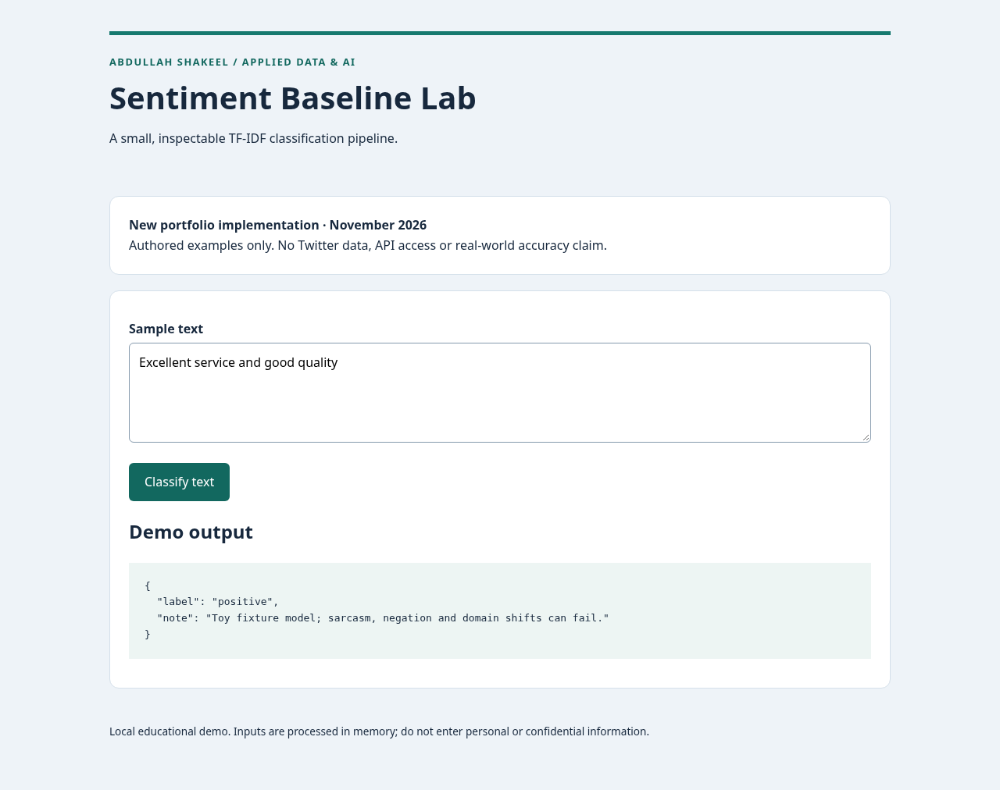

# Sentiment Baseline Lab

Demonstrate a reproducible positive/negative/neutral text-classification pipeline before collecting a representative dataset.

**Status:** new portfolio implementation, November 2026. Inspired by an idea in Abdullah Shakeel’s CV; not original historical project code. Working Python web demo; no deployment claim.



## Problem and intended users

Reviewers learning how vectorization, train-only fitting, baselines and abstention work.

## Features and architecture

TF-IDF unigram/bigram features; logistic regression; explicit out-of-vocabulary abstention; fixed authored holdout; confusion matrix and majority-class baseline.

```text
Authored CSV → train partition → TF-IDF + logistic regression pipeline → Flask form inference. Evaluation reads only the held-out partition after fitting.
```

Scikit-learn pipelines fit the vocabulary only on training text and keep training/inference transformations consistent. NLTK is not required for this baseline.

## Run locally

Requires Python 3.12. From this repository directory:

```bash
python -m venv .venv
# Windows PowerShell: .venv\Scripts\Activate.ps1
. .venv/bin/activate
pip install -r requirements.txt
python app.py
```

Open http://127.0.0.1:5002 and submit the included fictional example. No credentials or external services are required. `.env.example` documents configuration, but Flask entry points use the documented fixed ports and do not load a .env file. Development servers bind to localhost. They are not production deployments.

## Validate and reproduce evaluation

```bash
pip install -r requirements-dev.txt
python -m pytest -q
python evaluate.py
```

`artifacts/evaluation.json` records the actual preparation run. Read its method alongside every metric. CI runs Python checks and evaluation on push/PR; GitHub-hosted CI has not run until publication. Actual desktop and mobile-width browser screenshots are in `artifacts/`. Those screenshots show the Python web interface, not a mobile binary.

## Data and provenance

data/examples.csv contains 33 hand-authored fictional texts. Labels and fixed split were authored for software demonstration. No external dataset is redistributed.

See [PROVENANCE.md](PROVENANCE.md) and [LICENSE-REVIEW.md](LICENSE-REVIEW.md). Newly authored source and fixtures use MIT; dependencies retain their own licenses. No CV numerical achievement is represented as a measured result.

## Limitations and responsible use

This is an implementation inspired by the CV Twitter sentiment idea, not a reproduction. It does not use Twitter/X data or APIs. Only 24 training and 9 test examples are included. Related wording makes holdout results optimistic. Sarcasm, negation, slang, multilingual text and domain shift are not validated. Output labels are not certainty estimates.

Inputs are processed in memory; application code does not persist form contents. Standard web-server request metadata may still appear in local logs. Use fictional examples, never confidential employer, applicant, patient or billing information. No authentication or production abuse protection is included; keep this demo local.

## Future improvements

Obtain an appropriately licensed, representative three-class social-text dataset; document collection consent and terms, deduplicate by source/user where appropriate, select hyperparameters on validation only, then evaluate once on an untouched test set with per-class errors.

## Repository guide

- `core.py`: data/model or matching logic.
- `app.py`, `templates/`: local web interface.
- `evaluate.py`: reproducible evaluation and method.
- `test_app.py`: functional and boundary validation.
- `.github/workflows/validate.yml`: Python CI definition.
- `artifacts/`: actual results and screenshots.

## Truthful application summary

Built a three-class text-classification demo using a train-only TF-IDF pipeline and logistic regression, with a majority baseline, confusion matrix and explicit abstention for unknown vocabulary.
