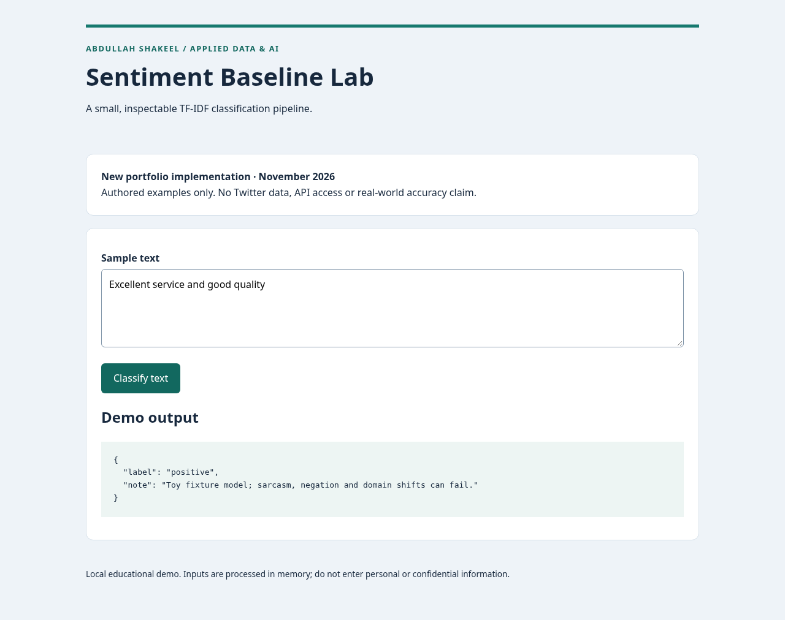

# Abdullah Shakeel · Data science & AI portfolio

I build Python applications that connect data, models and usable interfaces, with reproducible examples and explicit evaluation limits. Based in Islamabad, Pakistan; BS Information Technology, Bahria University (2021–2025), with a focus on Data Science and AI.

[Profile, experience and skills](PORTFOLIO.md) · [Application summaries by role](CAREER-NOTES.md) · [Audit and validation](PORTFOLIO-AUDIT.md)

| Project | Evidence to inspect | Start here |
| --- | --- | --- |
| Interview Evidence Lab | Deterministic skill matching, human review, Flask validation | [Code and demo](https://github.com/Abdulllah999/interview-evidence-lab) |
| Sentiment Baseline Lab | Train-only TF-IDF, three classes, authored holdout and abstention | [Code and evaluation](https://github.com/Abdulllah999/sentiment-baseline-lab) |
| Market Forecast Lab | Chronological evaluation, sentiment ablation, persistence baseline | [Code and evaluation](https://github.com/Abdulllah999/market-forecast-lab) |
| Health Pattern Explorer | Synthetic model-serving API, educational limits, Flutter companion source | [Code and demo](https://github.com/Abdulllah999/health-patterns-demo) |
| Retention Command Center | Streamlit scenarios, exact-formula baseline and SQL reconciliation | [Dashboard details below](#retention-command-center--churn-simulator) · [SQL report](analytics/README.md) |

The four labs are new portfolio implementations inspired by CV project ideas, not recovered university applications. Each project is independently runnable: open its repository README, clone it, then install its requirements. Evaluation data is authored or synthetic; the results do not establish real-world outcomes. Flutter and Docker builds are not validated. No application deployment is claimed.

All four labs are published in separate repositories and featured on [my profile](https://github.com/Abdulllah999). GitHub Actions validates the Python applications. Original branches and default-branch project snapshots are preserved; use the linked individual repositories for current project work. [Profile settings and recommended pins](GITHUB-SETUP.md).

---

# Retention Command Center & Churn Simulator

An interactive **synthetic risk-score simulator**, built with Python, Streamlit, Scikit-learn and Plotly. This update preserves the original dashboard and corrects its probability and unsupported growth claims.



## Problem and users

Explore how an invented customer-risk rule changes with engagement and support-ticket inputs. Intended for recruiters and developers inspecting a small ML dashboard, not for real retention decisions.

## Features and architecture

300 seeded fictional customers → fixed 240/60 train/test split → random forest regressor → interactive scenario controls, cohort plots and held-out evaluation.

The target is `clip(100 - engagement + 7.5 * support_tickets, 0, 100)`, rounded to one decimal. It is a score, **not an observed churn label or calibrated probability**. Monthly spend and tenure are unrelated distractor features in the generator. An exact formula baseline scores zero MAE by construction and is more appropriate than ML when the formula is known. Feature importance does not establish causality; changing sliders does not measure intervention impact.

## Setup and usage

Requires Python 3.12:

```bash
python -m venv .venv
. .venv/bin/activate
pip install -r requirements.txt
streamlit run myfile.py --browser.gatherUsageStats=false
```

Open http://localhost:8501. Use cohort filters and fictional customer sliders. The real entry point is `myfile.py`; no `app.py` or Vercel deployment is implied. No secrets or external data are required.

## Validation and evaluation

```bash
pip install -r requirements-dev.txt
python -m pytest -q
python evaluate.py
```

Tests cover seeded data, bounded scores, the exact-formula baseline, mean-baseline comparison, application startup and empty cohort filters. See `artifacts/evaluation.json` for measured MAE/R² and baselines, and `artifacts/demo.png` for the actual running dashboard. GitHub Actions has passed on the published main branch; see the repository Actions tab for the latest run. No latency measurement is claimed.

## Data, ownership and limitations

All rows are synthetic; no employer, billing or real customer data is used. The original public code had no license; see LICENSE-REVIEW.md before applying one. New changes are prepared for the repository owner. No historical activity, real churn accuracy, revenue growth, business impact or deployment is established.

## Future improvements

Collect a legally usable observed-churn dataset, define a prediction date and horizon, remove post-outcome leakage, use chronological/customer-separated evaluation, assess calibration and subgroup errors, and compare a simple classifier before adding complexity. A SQL reporting exercise can demonstrate analyst skills once the underlying data is credible.

## Application summary

Improved a Streamlit synthetic risk simulator by extracting reproducible model logic, evaluating held-out error against mean and exact-formula baselines, and adding validation for empty filters.

## SQL reporting

[SQL cohort analysis](analytics/README.md) adds a CTE, conditional aggregation and window-based cohort shares over the same synthetic snapshot. Run `python report.py`; this is a reproducible SQL example, with no observed churn or revenue claims.
